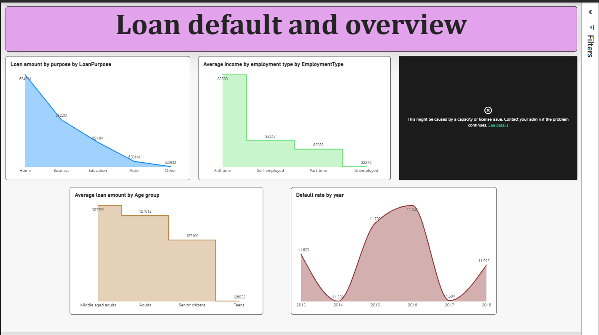
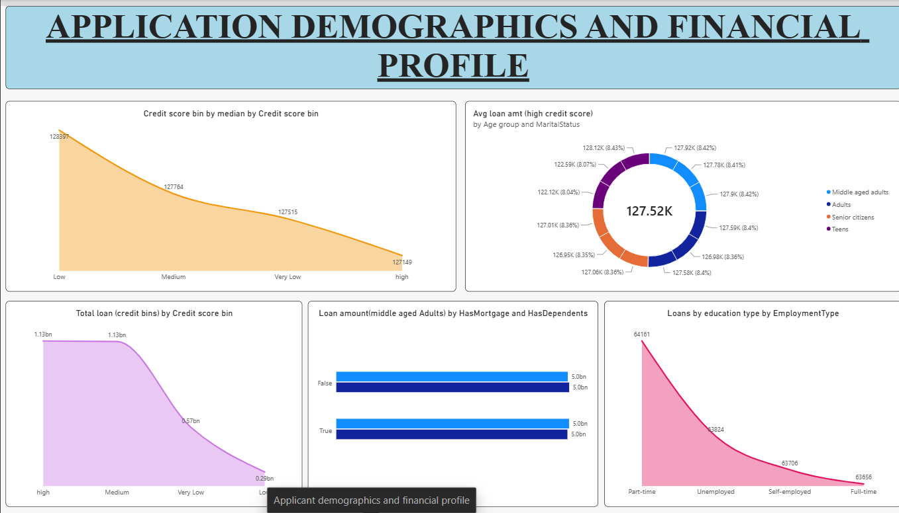
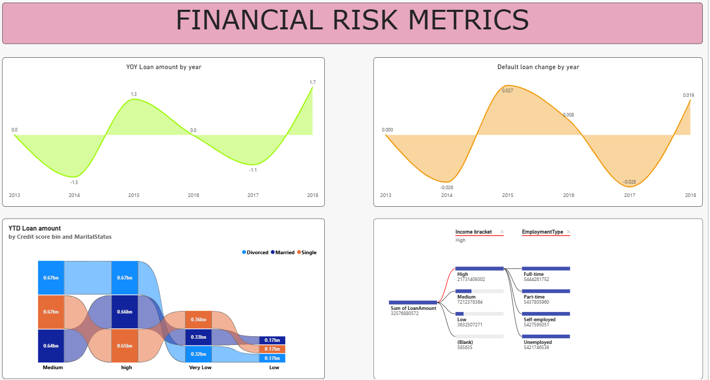

# Loan Default Risk Analysis | SQL Server & Power BI

An end-to-end data analytics project exploring loan applications, borrower profiles, loan characteristics, and default patterns using SQL Server, Power BI, Power Query, and DAX-based calculations.

> **Project status:** Dashboard and Power BI report files are included. The source CSV is not included yet; add it only after confirming that its license/usage terms permit redistribution.

## Project Overview

This project analyzes a loan dataset containing borrower attributes, financial information, loan characteristics, and a binary loan-default indicator. The Power BI report presents the data through three report pages, moving from a high-level overview to borrower demographics and financial-risk metrics.

The objective is to explore how loan attributes and borrower characteristics vary across the dataset and to make those patterns easier to inspect through interactive visualizations.

## Tools & Technologies

- **SQL Server** — database and table setup; accessing and inspecting the source data.
- **SQL Server Management Studio (SSMS)** — connecting to the SQL Server database and working with its tables.
- **Power BI Desktop** — importing data, building the data model, creating report pages, and designing visuals.
- **Power Query Editor** — data formatting, cleaning, and transformation within Power BI.
- **DAX** — measures and calculations used in the report.

## Workflow

1. Set up the database and tables in SQL Server.
2. Use SSMS to connect to the database and access/inspect the tables.
3. Import the required data from SQL Server into Power BI Desktop.
4. Apply additional formatting, cleaning, and transformation steps in Power Query Editor.
5. Create the required calculations and measures using DAX.
6. Build the report pages and visualizations in Power BI.
7. Publish the report to Power BI Service.

**Scope clarification:** SQL Server/SSMS was used for database and table setup and for accessing/inspecting the data. The data-cleaning and formatting work described in this project was performed in Power Query Editor; this README does not claim that SQL-based data cleaning was performed.

## Dashboard Pages

### 1. Loan Default and Overview

Provides a high-level view of loan amounts and selected borrower/application attributes, including loan purpose, employment type, age group, and default rate by year.



### 2. Applicant Demographics and Financial Profile

Explores applicant and loan characteristics through credit-score groupings, age groups, marital status, mortgage/dependent indicators, education, and employment type.



### 3. Financial Risk Metrics

Presents year-over-year loan amount and default-related changes, year-to-date loan amount analysis, and comparisons across credit-score and applicant categories.



## Dataset

The supplied CSV contains **255,347 rows and 19 columns**. Fields include:

- Loan identifier
- Age and income
- Loan amount, interest rate, and loan term
- Credit score and number of credit lines
- Months employed and debt-to-income ratio
- Education, employment type, and marital status
- Mortgage, dependents, and co-signer indicators
- Loan purpose, default indicator, and loan date

The raw CSV is intentionally not included in this initial repository package. Before adding it, confirm the dataset's source, license, and permission to redistribute it. Do not upload confidential, personal, or restricted data.

## Key Dataset Notes

- The uploaded CSV has 255,347 records and 19 columns.
- The `Default` field is represented as a binary indicator in the supplied CSV.
- The date field is named `Loan Date (DD/MM/YYYY)`, but sample values such as `10/15/2018` appear to use a month/day/year representation. Confirm the parsing locale and date conversion in Power Query before relying on date-based analysis.
- Any percentages, totals, or trends shown in the report should be interpreted in the context of the report's filters and measure definitions.

## Power BI Report

[Open the published Power BI report](https://app.powerbi.com/groups/888efbd0-2975-47f4-b268-2a3a28e089a3/reports/f453abc2-222e-4d48-ab5e-a645d99f15b2/dcccaa89893eea177912?experience=power-bi)

Access depends on the permissions configured in Power BI Service. Viewers may need to sign in and have permission to the workspace/report. This link is not represented as a public anonymous link.

## Repository Structure

```text
loan-default-risk-analysis/
├── README.md
├── dashboard/
│   └── loan-default-risk-analysis.pbix
├── screenshots/
│   ├── 01-loan-default-overview.png
│   ├── 02-applicant-demographics-financial-profile.png
│   └── 03-financial-risk-metrics.png
└── documentation/
    └── project-overview.md
```

## How to Explore

1. Browse the screenshots in the `screenshots/` folder.
2. Open the `.pbix` file in Power BI Desktop to inspect the report and model.
3. If you have access to the underlying source database, configure the relevant connection and refresh the data as required.
4. Use the published Power BI report link above if your account has access.

The PBIX file may require the original data source or connection settings to refresh successfully on another machine.

## Limitations & Future Improvements

- Add a source-data citation and redistribution license/permission details.
- Include a sanitized sample dataset if redistribution is permitted.
- Document the Power Query transformation steps and data model in more detail.
- Validate date parsing and the definitions of year-over-year and year-to-date calculations.
- Add a concise business interpretation for each major finding after validating the underlying measures.

## Author

**Add your name here**

Data Analytics | SQL Server | Power BI | Power Query | DAX
